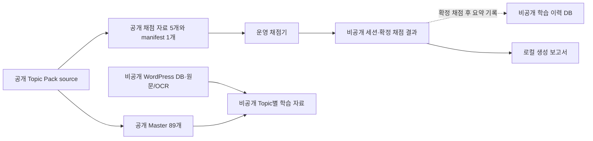

# 공개 데이터·비공개 운영 데이터·보고서 인벤토리

기준 시점: **2026-11-13 (KST)**. 조사 당시 공개 기준은 GitHub `main`
[`30b13262`](https://github.com/now0930/prof_eng_answer/commit/30b13262ad3899919edae7cb72be3ddeca677f18),
운영 기준은 `~/hermes/workspace/prof_eng_answer`의 당시 같은 HEAD다.
아래 수량은 이 문서와 함께 반영하는 변경을 제외한 파일시스템·Git 인덱스
스냅샷이다. 이후 커밋에서는 공개 Git 파일 수가 달라질 수 있다.

이 문서는 **경로와 저장 책임의 인벤토리**다. 개인 답안, 채점 진단 본문,
WordPress 원문/OCR, 비밀값, 세션 식별자, DB 행은 싣지 않는다. `Git 추적`은
공개 저장소에 있는지의 기준이며, `Git 비추적`만으로 비공개 여부·완전한
백업 여부를 증명하지 않는다. 별도 명시가 없으면 수량은 파일 수다.

## 1. 저장 경계와 데이터 흐름

운영 Compose는 호스트 `~/hermes/workspace`를 컨테이너 `/workspace`에 bind
mount하고 Bot의 작업 경로를 `/workspace/prof_eng_answer`로 지정한다. 따라서
운영 `data/`와 `reports/`는 코드 checkout 안에 있지만 Git 경계는 다르다.
원본 답안과 `grade.json`은 세션 파일에 있으며 학습 이력 DB에는 문제·시도·점수·요약 진단·복습 상태만 기록된다. DB 기록에 실패해도 확정 채점 파일은 유지된다.
`~/hermes/.env`가 Bot 환경변수를 주입한다. 별도 DB Docker 볼륨으로
자동 분리되는 구조가 아니다. 상세 소비 경계는 [시스템 구조](system_architecture.md),
배포 설정은 호스트 `~/hermes/docker-compose.yml`을 확인한다.

## 2. 공개 Git 데이터

`main`에서 추적되는 파일은 **1,913개**다. 실제 `.env`, SQLite DB,
`data/sessions/` 파일은 추적되지 않는다. 주요 공개 자료는 다음과 같다.

| 경로 | 수량 | 책임 |
| --- | ---: | --- |
| `rubrics/topic_packs/` | Topic 89개, 파일 467개, Fact Anchor 2,096개 | canonical 채점 source. Anchor 수가 곧 전부의 채점 적격성·독립 검증을 뜻하지 않는다. |
| `rubrics/generated/` | 6개 | 채점 자료 5개와 주제 목록 manifest 1개. 공식 절차로 생성하며 직접 편집하지 않는다. |
| `master_topic_packs/` | 89개 | Topic ID·출처 참조·학습/진단 View 계약. |
| `calibration/` | 32개 | 공개 Golden·회귀 입력과 정책. 실제 개인 채점 기록과 구분한다. |
| `data/question_contract_cache/` | JSON 12개 | 현재 공개된 문제 계약 캐시. `data/` 전체가 비공개인 것은 아니다. |
| `reports/` | 244개 | Git에 선별 반영된 기준·감사 보고서. 개별 보고서의 공개 적합성은 내용 검토가 필요하다. |
| `docs/`, `schemas/`, `scripts/`, `tests/` | 각각 276, 23, 325, 208개 | 문서·스키마·도구·검증 코드. |

공개 Topic Pack은 개인 오개념·원본 답안·점수를 저장하지 않는다.
비공개 학습 자료에서 새 Fact 후보가 나오더라도 [Fact Anchor 적격성 정책](fact_anchor_eligibility_policy.md)의
근거·중복·승인 경계를 거친다. 공개 보고서는 과거 실행 이력일 수 있으므로
현재 필수 검증이나 최신 운영 상태로 자동 해석하지 않는다.

## 3. 운영 checkout의 `data/`

`data/`에는 **17,498개 파일, 485,537,695바이트**가 있었다. Git 추적 12개,
비추적 17,486개다. 아래 `로컬 전용` 자료는 개인 정보나 비공개 원문이
섞일 수 있으므로 전체를 비공개로 취급한다.

| 하위 경로 | 파일 수 | Git 상태 | 내용과 보존 원칙 |
| --- | ---: | --- | --- |
| `data/` 직속 | 7 | 비추적 | `state.json`, 학습 이력 SQLite 1개, WordPress 원본/매칭 SQLite 2개, 이전 WordPress SQLite 사본 3개. 현재 운영 DB와 시점별 사본을 구분한다. |
| `data/sessions/` | 17,349 | 비추적 | 문제·원본 답안·OCR·채점 세션 등. 개인 식별자와 확정 채점 결과가 포함될 수 있다. |
| `data/final_grade_cache/` | 61 | 비추적 | 확정 채점 관련 캐시. 원본 세션·점수와 함께 보존한다. |
| `data/wordpress_topic_packs/` | 55 | 비추적 | 승인된 Topic 연결을 바탕으로 만든 학습용 WordPress 원문 묶음. canonical Fact나 채점 Bank가 아니다. |
| `data/topic_learning_authoring/` | 7 | 비추적 | 로컬 학습 자료 작성 산출물. |
| `data/topic_learning_synthesis/` | 6 | 비추적 | 로컬 학습 자료 합성 산출물. |
| `data/user_settings/` | 1 | 비추적 | 개인 설정. |
| `data/question_contract_cache/` | 12 | **공개 추적** | 공개 문제 계약 캐시. 개인 세션 저장소와 혼동하지 않는다. |

학습 DB 기본 경로는 `data/training_history.sqlite3`다. 코드상 학습자·문제·
시도·점수·진단·복습 상태를 저장한다. 원본 답안 전문이나 확정 `grade.json` 전체를 저장하지 않는다. 2026-11-13에 `now0930:now0930`
소유로 복구하고 `codex_now0930`에는 해당 파일의 읽기 ACL을 부여했다.
읽기 전용 `PRAGMA quick_check`는 `ok`였다. 이 사실은 Bot의 `/review`
실사용 테스트를 대신하지 않는다. 개인별 교정·유도 과정 전체 스키마가
구현됐다는 뜻도 아니다.

## 4. 운영 checkout의 `reports/`와 기타 로컬 자료

`reports/`에는 **7,171개 파일, 115,801,507바이트**가 있었다. 공개 추적
244개와 비추적 6,927개를 별도로 관리한다.

| 경로 | 파일 수 | Git 상태 | 취급 |
| --- | ---: | --- | --- |
| `reports/` 직속 | 251 | 공개 244 / 비추적 7 | 공개 기준·감사 기록과 로컬 검토 산출물이 섞여 있다. |
| `reports/release_candidates/` | 6,910 | 비추적 | 로컬 후보·실행 결과. 개인정보·프롬프트 포함 가능성을 전제로 비공개 취급. |
| `reports/telegram_regrade_batches/` | 8 | 비추적 | 채점 재실행 묶음. 원본 답안·결과의 노출에 주의. |
| `reports/rubric_bank/` | 2 | 비추적 | 로컬 Bank 검증 출력. |
| `wordpress_docs/` | 1,225 | 비추적 | 로컬 WordPress 문서·추출물. 공개 Topic Pack과 구분. |
| `logs/` | 1 | 비추적 | Bot 로그. 개인 식별자·오류 문맥이 있을 수 있다. |

그 밖에 `gemini_script/` 177개, `rubrics/content_candidates/` 2개,
`tmp/` 1개, 로컬 `docker-compose.yaml` 1개와 비추적 실험 스크립트가 있다.
이들은 공개 Git에 없는 **로컬 작업 자료**이며 모두 개인 데이터라는 뜻은
아니다. 현행 운영 백업 스크립트는 이 작업 자료 전체를 백업 대상으로
약속하지 않는다. `.env`는 `~/hermes/`와 `~/hermes/workspace/`에 존재하며
내용을 공개하지 않는다.

## 5. 중앙 비공개 백업

정식 저장 위치는 `~/hermes/private_backups/prof_eng_answer/`다. 소유자
계정의 읽기 전용 집계에서 다음이 확인됐다. 바이트는 각 묶음의 일반 파일
합계다. `OK`는 해당 manifest의 상태이고, 별도 형식의 보관 묶음에는
같은 상태 필드가 없을 수 있다.

| 묶음 | 파일 수 | 바이트 | manifest 상태 | SQLite 수 |
| --- | ---: | ---: | --- | ---: |
| 2026-11-09 운영 스냅샷 | 17,426 | 479,466,328 | OK | 6 |
| 2026-11-10 운영 스냅샷 | 17,460 | 434,547,913 | OK | 5 |
| 2026-11-11 운영 스냅샷 | 17,493 | 480,185,985 | OK | 6 |
| 2026-11-12 운영 스냅샷 | 17,504 | 531,162,298 | OK | 7 |
| 2026-11-13 운영 스냅샷 | 25,903 | 661,390,463 | OK | 9 |
| 격리된 미완전 과거 사본 | 17,337 | 241,917,631 | 루트 manifest 없음 | 별도 확인 필요 |
| Codex 비공개 DB 과거 보관 | 18,533 | 787,050,320 | 루트 manifest 없음 | 별도 검증 기록 |
| Compose 과거 사본 | 6 | 11,604 | 루트 manifest 없음 | 해당 없음 |
| 저장소 과거 백업 | 344 | 287,706,488 | 루트 manifest 없음 | 별도 확인 필요 |
| SSD에서 선별 보존한 고유 자료 | 50 | 2,615,758 | 루트 manifest 없음 | 별도 확인 필요 |
| 작업 공간 과거 아카이브 | 14,551 | 210,095,230 | 루트 manifest 없음 | 별도 확인 필요 |
| `pro_engineer` 선별 보존 | 2,170 | 73,478,933 | OK(별도 형식) | 0 |
| 보조 worktree의 개인 세션 보존 | 8 | 118,893 | 상태 필드 없음 | 0 |

**복원 기준:** 날짜별 운영 스냅샷은 `manifest.status=OK`, 해당 DB의
`quick_check=ok`, 백업 파일 해시와 필요한 `runtime/data`를 확인한다.
`_incomplete_review`는 정상 복원 후보로 취급하지 않는다. 다른 아카이브의
`루트 manifest 없음`은 형식 차이일 수 있으나 완전성을 자동 보증하지 않는다.
백업 목록·파일명·내용·인증정보를 공개 Git이나 채팅에 복사하지 않는다.

현재 [백업 스크립트](../scripts/backup_private_runtime.py)는 `data/`,
`logs/`, `reports/`, `wordpress_docs/`, 존재하는 환경/Compose 설정과
찾은 SQLite DB를 중앙 경로에 보존한다. SQLite는 online backup과
`quick_check`를 사용하고 다른 실시간 파일은 최선 노력 복사다.
WordPress/Immich 등 별도 서비스 DB, Hermes Docker `/opt/data` 볼륨,
`gemini_script/`와 `tmp/` 전체는 포함되지 않는다. 복원 절차와 범위는
[비공개 운영 데이터 백업](private_runtime_backup.md)을 따른다.

## 6. 공개 전 점검과 이 문서의 갱신 기준

- `git ls-files` 결과를 **공개 후보**로 보고, 실제 DB·`.env`·세션·원문 OCR·
  개인 답안·비공개 채점 결과가 포함되지 않았는지 내용 검토한다.
  `.gitignore`는 `git add -f`나 과거 커밋 노출을 막는 보안 경계가 아니다.
- 비추적 파일을 정리할 때는 중앙 백업의 해당 자료와 복원 경로를 먼저
  확인한다. 파일 수가 비슷하다는 사실만으로 백업 일치를 판정하지 않는다.
- 이 문서의 수량은 특정 시점의 인벤토리다. Topic Pack, 세션, 보고서,
  백업이 늘면 같은 기준으로 재집계하고 기준 날짜와 Git SHA를 함께 바꾼다.
- 이 인벤토리는 개인 답안이나 DB 행을 검토한 결과가 아니다. 공개 자료의
  내용상 비밀 누출 여부를 전수 인증하지 않는다.
